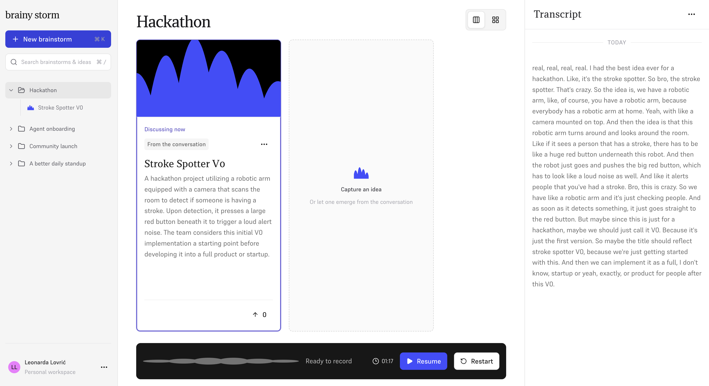

# Brainy Storm

A real-time brainstorming companion: it listens to your team, transcribes the conversation, and turns it into a live board of ideas with pros, cons and competitors.



## Run

Requires Docker, a Gradium API key and a Gemini API key.

```bash
cp .env.example .env   # set GRADIUM_API_KEY and GEMINI_API_KEY
docker compose up --build
```

Open **http://localhost:5173**, allow microphone access and press **Start**. Each run starts a fresh session.

Settings (models, chunk sizes, intervals) live in `configs/default.yaml`. Stop with `docker compose down`.
